# 🦯 Smart Cane — Bastón Inteligente

<p align="center">
  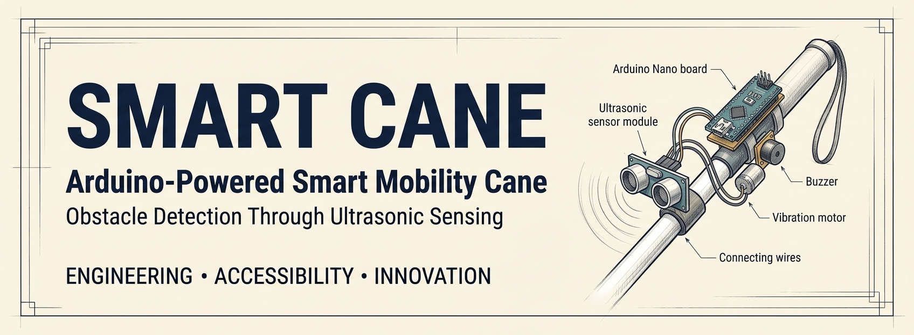
</p>

<p align="center">
  <strong>Desarrollo de un bastón inteligente para la detección de obstáculos mediante Arduino y sensores ultrasónicos.</strong>
</p>

<p align="center">
  <a href="https://www.arduino.cc/"></a>
  <a href="https://isocpp.org/"></a>
  <a href="https://www.arduino.cc/en/software/"></a>
  <a href="LICENSE"></a>
</p>

## Descripción

**Smart Cane** es un prototipo de bastón inteligente desarrollado con Arduino Nano, cuyo objetivo es detectar obstáculos cercanos mediante un sensor ultrasónico y advertir sobre su proximidad mediante señales sonoras y vibraciones.

El sistema mide la distancia entre el sensor y un objeto, procesa la lectura y activa diferentes patrones de alerta según los umbrales programados. Cuanto más cerca se encuentra el obstáculo, mayor es la frecuencia del sonido y más frecuentes son los pulsos de vibración.

El proyecto combina programación en C++, electrónica, integración de hardware y experimentación, con un enfoque educativo orientado a explorar soluciones tecnológicas para la accesibilidad.

## Objetivos

* Implementar un sistema de detección de obstáculos utilizando ultrasonido.
* Procesar las mediciones con una placa Arduino Nano.
* Generar alertas sonoras y vibratorias según la distancia.
* Integrar componentes electrónicos en un prototipo funcional.
* Registrar mediciones y analizar el comportamiento del sistema.
* Aplicar conocimientos de programación, electrónica y desarrollo de prototipos.

## Características principales

* **Detección ultrasónica:** medición de distancias con el sensor HC-SR04.
* **Alertas sonoras:** modificación de la frecuencia del zumbador según la proximidad.
* **Alertas vibratorias:** activación de un motor vibratorio mediante una señal digital.
* **Monitoreo serial:** visualización de las distancias medidas a través del monitor serie.
* **Control por umbrales:** cuatro estados de funcionamiento definidos en el programa.
* **Documentación experimental:** fotografías de construcción y gráficas de las pruebas.

## Tecnologías y herramientas

<p align="center">
  
  
  
  
  
  
</p>

| Tecnología o herramienta | Aplicación                                      |
| ------------------------ | ----------------------------------------------- |
| Arduino Nano             | Procesamiento y control del dispositivo         |
| C++                      | Programación de la lógica de detección          |
| Arduino IDE              | Compilación y carga del programa                |
| HC-SR04                  | Medición ultrasónica de distancias              |
| Git y GitHub             | Control de versiones y publicación del proyecto |
| Mermaid                  | Diagramas de funcionamiento y lógica            |

El programa utiliza las funciones integradas del entorno Arduino, como `digitalWrite()`, `pulseIn()`, `tone()` y `noTone()`. No incluye bibliotecas externas mediante directivas `#include`.

## Componentes electrónicos

Los componentes contemplados en el desarrollo incluyen:

* Arduino Nano.
* Sensor ultrasónico HC-SR04.
* Zumbador.
* Motor vibratorio de tipo moneda.
* Transistor 2N2222 para controlar el motor.
* Diodo 1N4007.
* Resistencia para el circuito de control.
* Batería de ion de litio de 3,7 V.
* Módulo de carga TP4056.
* Interruptor.
* Protoboard y cables Dupont.
* Estructura física para el bastón.

<p align="center">
  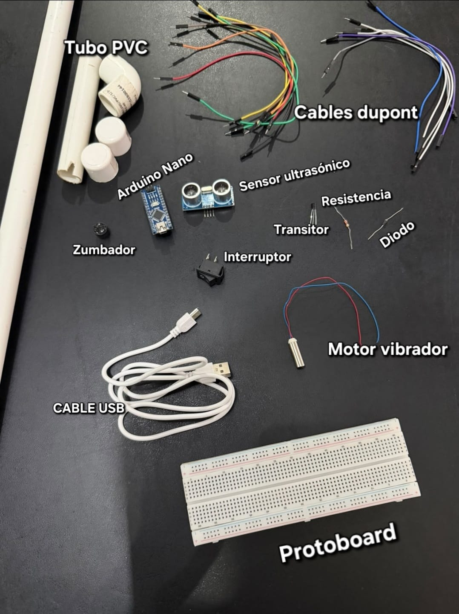
</p>

<p align="center"><em>Materiales empleados durante el desarrollo del prototipo.</em></p>

### Circuito electrónico

<p align="center">
  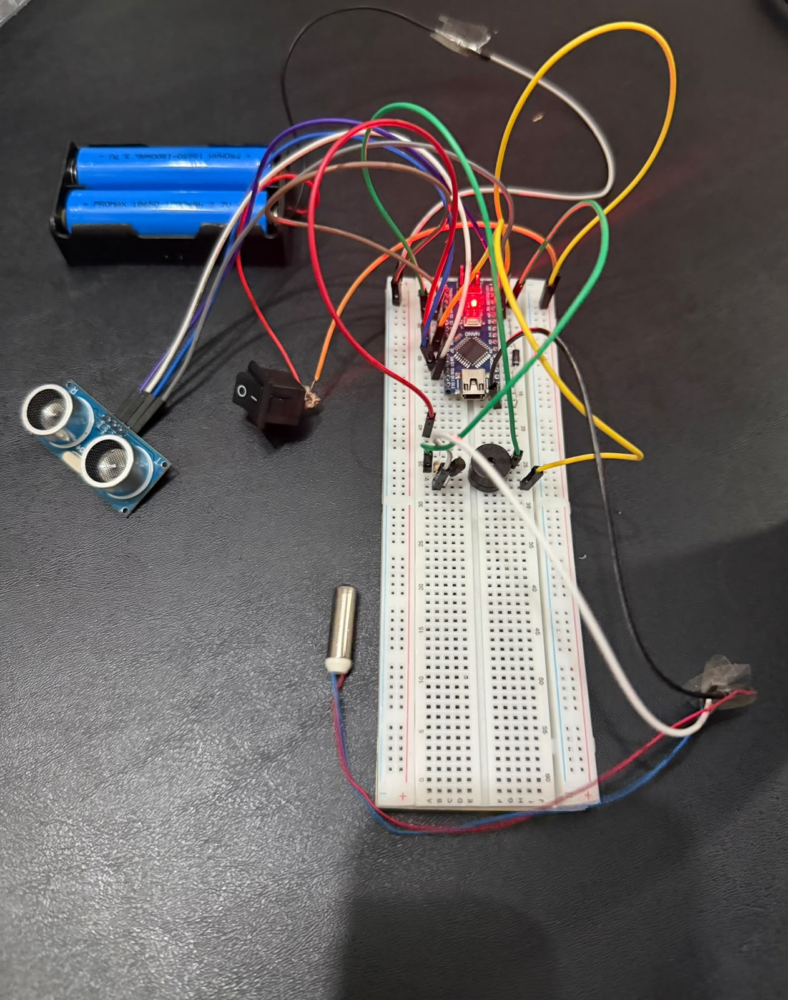
</p>

<p align="center"><em>Referencia visual del circuito electrónico del proyecto.</em></p>

**Consideración eléctrica:** el motor vibratorio no debe alimentarse directamente desde un pin de Arduino si supera la corriente que este puede suministrar. Debe utilizarse una etapa de control apropiada. También es necesario verificar la polaridad, la conexión del transistor, el diodo de protección y la alimentación antes de encender el circuito.

## Arquitectura y funcionamiento

El sistema sigue un ciclo de lectura, cálculo, clasificación y generación de alertas.

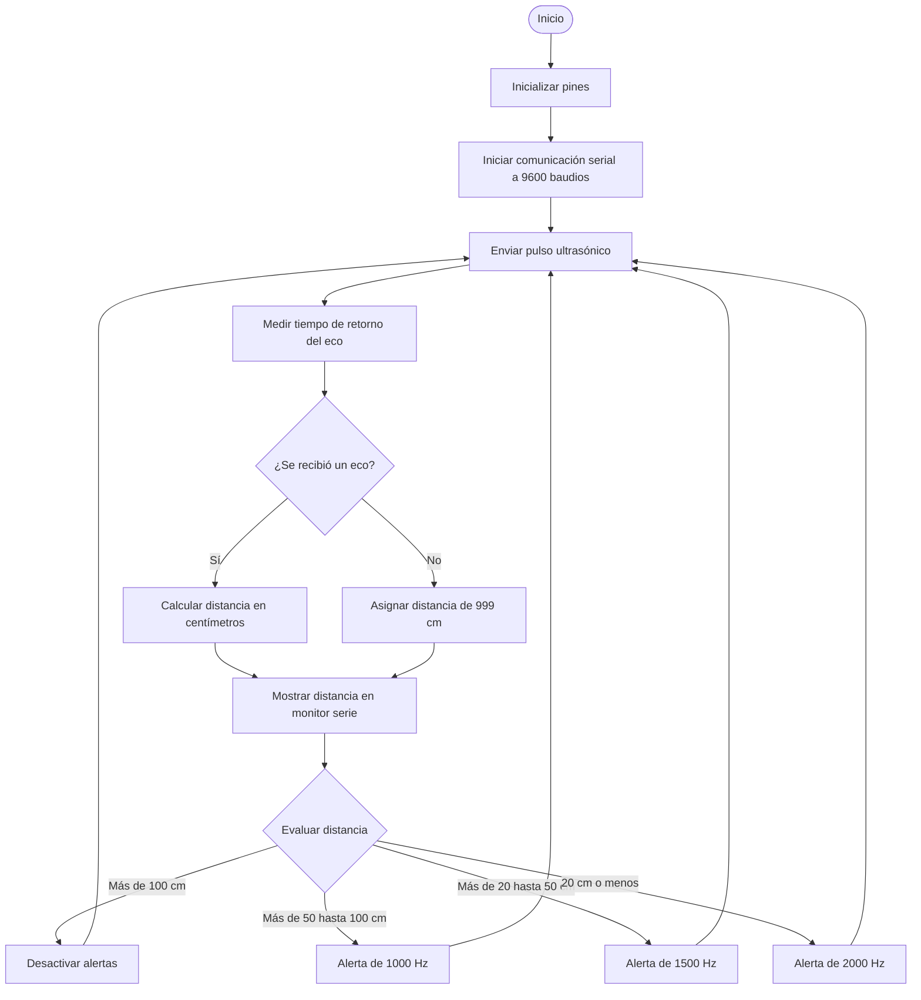

### Cálculo de la distancia

El sensor HC-SR04 mide el tiempo que tarda el pulso ultrasónico en llegar al objeto y regresar. El programa utiliza ese tiempo para estimar la distancia:

$$
d=\frac{t \times 0.0343}{2}
$$

Donde:

* \(d\) es la distancia en centímetros.
* \(t\) es el tiempo de retorno del eco en microsegundos.
* \(0.0343\) es una aproximación de la velocidad del sonido en centímetros por microsegundo.
* Se divide entre dos porque el sonido recorre el trayecto de ida y vuelta.

El código utiliza `pulseIn(ECHO_PIN, HIGH, 30000)`, que establece un tiempo máximo de espera de 30.000 microsegundos para recibir el eco.

## Configuración de pines

La configuración definida en `Baston.ino` es la siguiente:

| Componente                   | Pin de Arduino | Configuración |
| ---------------------------- | -------------- | ------------- |
| TRIG del HC-SR04             | D9             | Salida        |
| ECHO del HC-SR04             | D10            | Entrada       |
| Zumbador                     | D6             | Salida        |
| Control del motor vibratorio | D5             | Salida        |

La asignación de pines corresponde al código fuente. Antes de ejecutar el programa, verifica que las conexiones físicas del circuito coincidan con esta tabla.

## Lógica de alertas

El programa clasifica las distancias en cuatro estados:

| Distancia medida            | Frecuencia sonora | Comportamiento de la vibración    |
| --------------------------- | ----------------: | --------------------------------- |
| Más de 100 cm               |        Sin sonido | Desactivada                       |
| Más de 50 cm y hasta 100 cm |           1000 Hz | Pulso de 150 ms y pausa de 500 ms |
| Más de 20 cm y hasta 50 cm  |           1500 Hz | Pulso de 150 ms y pausa de 200 ms |
| 20 cm o menos               |           2000 Hz | Pulso de 100 ms y pausa de 100 ms |

### Diagrama de decisión

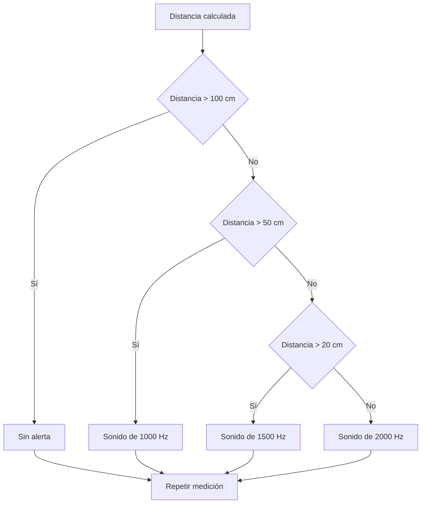

Las frecuencias y los intervalos anteriores proceden del programa implementado. El sistema no incorpora todavía filtrado de lecturas ni un mecanismo avanzado para diferenciar obstáculos según su forma o superficie.

## Instalación y ejecución

### Requisitos

* Arduino IDE instalado.
* Una placa Arduino Nano.
* Un sensor HC-SR04 y los componentes del circuito.
* Un cable USB compatible con la placa.
* Un circuito correctamente conectado y alimentado.

### 1. Clonar el repositorio

```bash
git clone https://github.com/VITIDEV06/smart-cane-arduino.git
```

### 2. Acceder al directorio

```bash
cd smart-cane-arduino
```

### 3. Abrir el programa

Abre `Baston.ino` con Arduino IDE.

### 4. Configurar Arduino IDE

1. Conecta el Arduino Nano.
2. Selecciona **Arduino Nano** como placa.
3. Elige el procesador correspondiente a tu modelo.
4. Selecciona el puerto correcto.
5. Comprueba las conexiones eléctricas.

### 5. Cargar el programa

Pulsa **Subir** en Arduino IDE y espera a que termine la compilación y la carga.

### 6. Comprobar las lecturas

Abre el monitor serie y configura la velocidad en **9600 baudios**.

El programa mostrará mensajes con este formato:

```text
Distancia: 45.00 cm
Distancia: 91.00 cm
Distancia: 15.00 cm
```

Estos valores son ejemplos del formato de salida, no mediciones garantizadas.

## Pruebas y resultados experimentales

El repositorio contiene gráficas y una hoja de cálculo para documentar las pruebas realizadas con el prototipo.

### Prueba a 15 cm

<p align="center">
  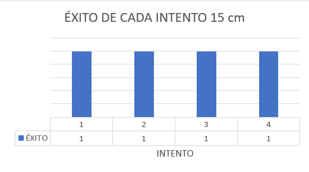
</p>

### Prueba a 45 cm

<p align="center">
  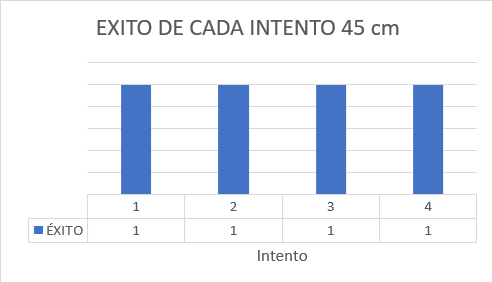
</p>

### Prueba a 91 cm

<p align="center">
  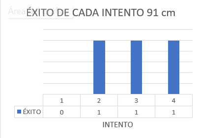
</p>

### Datos de las pruebas

[**Consultar el archivo de Excel con las gráficas y los datos experimentales**](results/GRAFICAS%20DE%20EXITO%20DEL%20BASTON.xlsx)

Las gráficas permiten documentar el comportamiento del prototipo a distintas distancias. Para establecer conclusiones cuantitativas sobre precisión, margen de error o tasa de éxito, es necesario analizar los valores registrados y compararlos con las distancias reales de referencia.

## Galería del desarrollo

### Proceso de construcción

<p align="center">
  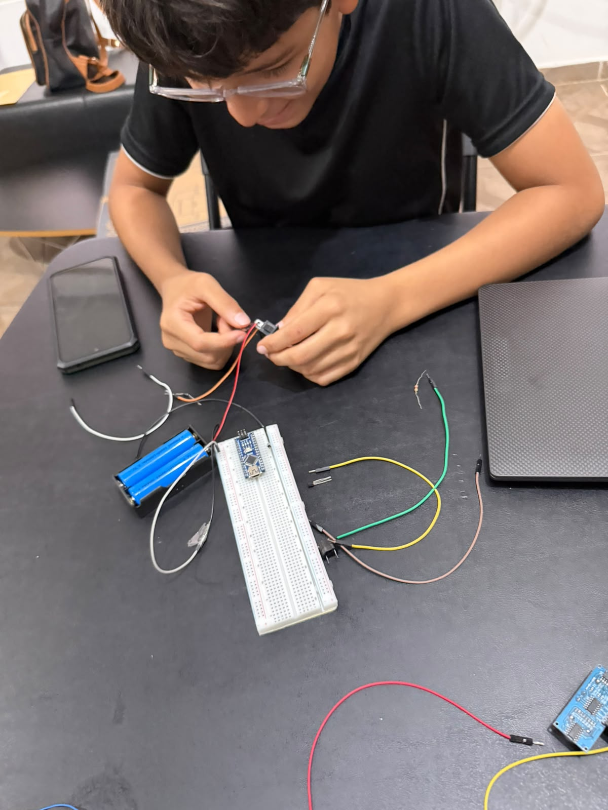
</p>

<p align="center">
  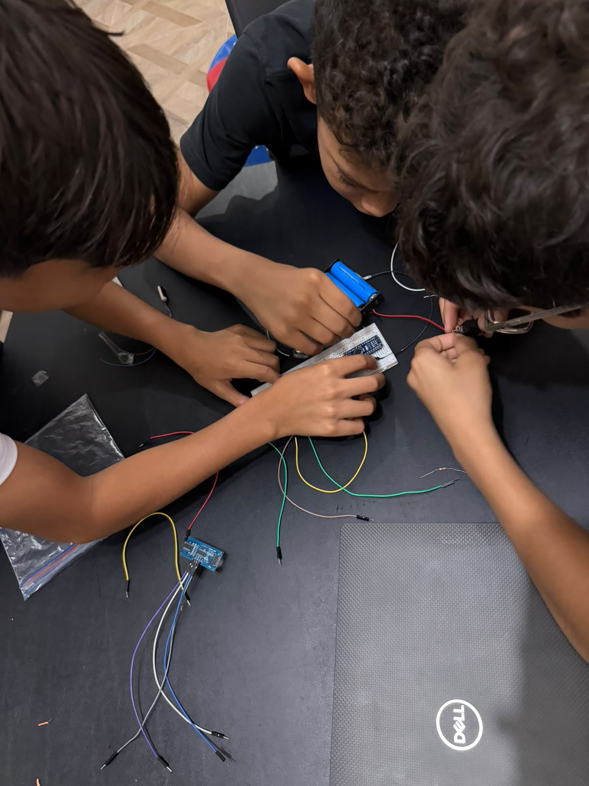
</p>

### Prototipo final

<p align="center">
  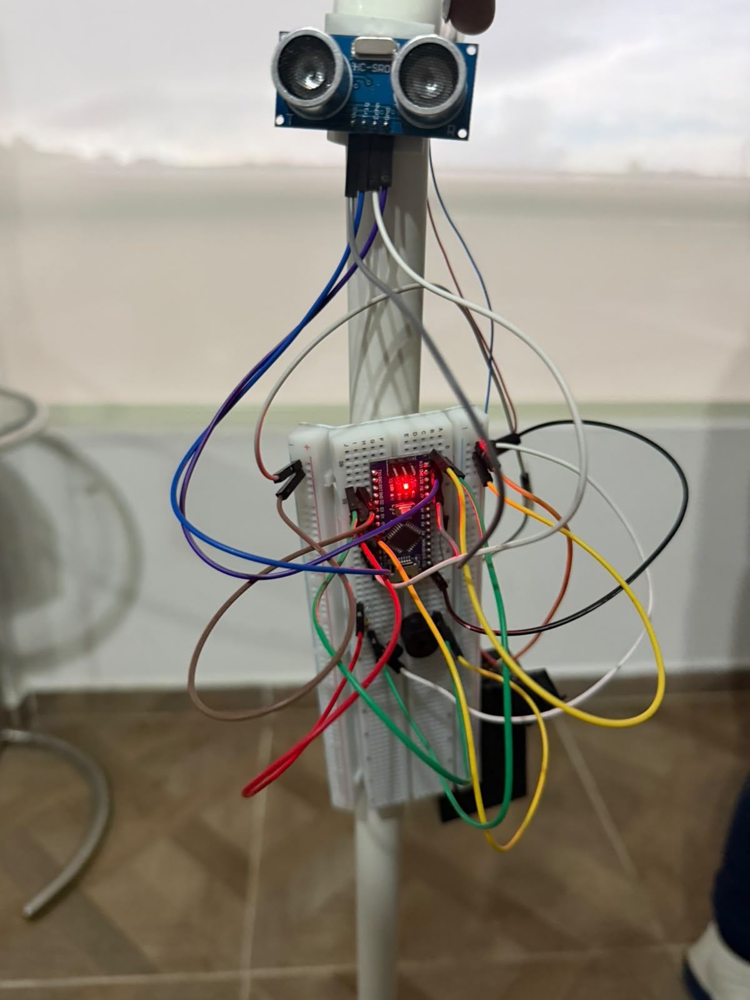
</p>

### Equipo de trabajo

<p align="center">
  
</p>

## Estructura del repositorio

```text
smart-cane-arduino/
├── Baston.ino
├── README.md
├── LICENSE
├── images/
│   ├── banner-smart-cane.jpg
│   ├── circuito-electronico.jpg
│   ├── construccion1.jpg
│   ├── construccion2.jpg
│   ├── equipo.jpg
│   ├── materiales.jpg
│   └── prototipo-final.jpg
└── results/
    ├── GRAFICAS DE EXITO DEL BASTON.xlsx
    └── graficas/
        ├── 15cm.png
        ├── 45cm.png
        └── 91cm.png
```

## Limitaciones conocidas

* **Lecturas sin eco:** cuando no se recibe un eco dentro del tiempo de espera, el programa asigna una distancia de 999 cm y desactiva las alertas. Por tanto, una lectura fallida puede interpretarse como ausencia de un obstáculo cercano.
* **Mediciones ultrasónicas:** la precisión puede verse afectada por la superficie del objeto, el ángulo de incidencia y las condiciones del entorno.
* **Ejecución bloqueante:** el uso de `delay()` limita la ejecución de otras tareas durante las pausas.
* **Alcance de las pruebas:** las mediciones documentadas no garantizan por sí solas un funcionamiento fiable en todos los entornos.
* **Seguridad:** el prototipo requiere validación adicional antes de considerar su uso en situaciones reales de movilidad.

## Mejoras futuras

* Incorporar filtrado de lecturas para reducir fluctuaciones.
* Diferenciar las mediciones fuera de rango de los errores de lectura.
* Sustituir las pausas con `delay()` por una lógica basada en `millis()`.
* Optimizar el consumo energético y la autonomía de la batería.
* Mejorar el montaje físico, la protección del circuito y la ergonomía.
* Realizar más pruebas en diferentes condiciones ambientales.
* Calcular métricas de precisión y error a partir de mediciones repetidas.
* Evaluar la respuesta del sistema ante diferentes tipos de obstáculos.

## Enfoque educativo y accesibilidad

El desarrollo de Smart Cane permite aplicar conocimientos de programación, electrónica y diseño de prototipos a un problema relacionado con la accesibilidad.

El proceso de construcción también ofrece una oportunidad para trabajar con sensores, actuadores, adquisición de datos y pruebas experimentales, fomentando el aprendizaje práctico y la exploración de soluciones tecnológicas.

## Aviso de seguridad

Este proyecto es un **prototipo educativo y experimental**. No es un dispositivo médico certificado ni sustituye un bastón de movilidad convencional, un perro guía u otras ayudas de orientación. No debe utilizarse como único medio para detectar peligros. Se requieren pruebas y validaciones adicionales para cualquier aplicación en situaciones reales.

## Autor

**Víctor David Montes**

* GitHub: [@VITIDEV06](https://github.com/VITIDEV06)
* Repositorio: [smart-cane-arduino](https://github.com/VITIDEV06/smart-cane-arduino)

## Licencia

Este proyecto se distribuye bajo la licencia **MIT**. Consulta el archivo [`LICENSE`](LICENSE) para conocer los términos de uso, modificación y distribución.

---

<p align="center">
  <strong>Smart Cane</strong><br>
  Ingeniería · Programación · Electrónica · Accesibilidad
</p>
